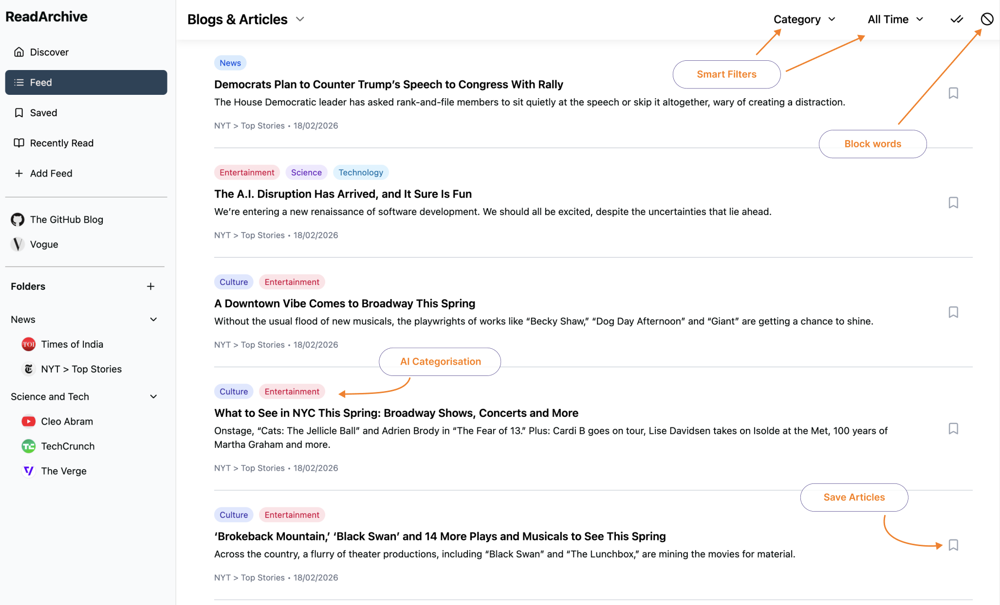

# ReadArchive

**Follow the websites, blogs, podcasts, and YouTube channels you care about—all in one reading feed.**

**Live app:** [Open ReadArchive](https://rss-app-delta.vercel.app/)

---

## Preview



---

## Contents

- [What is ReadArchive?](#what-is-readarchive)
- [What you can do](#what-you-can-do)
- [Try ReadArchive](#try-readarchive)
- [Using the app](#using-the-app)
- [Built with](#built-with)
- [Developing locally](#developing-locally)

---

## What is ReadArchive?

New articles and episodes are spread across many websites and services. ReadArchive brings updates from your chosen sources into one place, so you can browse, organize, and save what you want to read later.

Add a website or feed, then follow new items from your ReadArchive feed. Your saved items and reading history are available in their own views.

## What you can do

- **Follow sources:** Add supported websites, RSS feeds, podcasts, Reddit feeds, and YouTube channels by URL.
- **Browse your feed:** See new articles and episodes together, with category and time filters to narrow the list.
- **Keep useful reads:** Save items for later or mark them as read.
- **Organize sources:** Group sources into folders that suit the way you read.
- **Reduce unwanted topics:** Add words or phrases to your blocklist to hide matching items from the feed, source, and folder views.
- **Try it without an account:** Choose **Try Demo** on the landing page to explore a preloaded feed.

## Try ReadArchive

Choose **Try Demo** on the ReadArchive landing page to start exploring. The demo opens with sample sources and articles already in the feed, so you can try browsing and saving without signing up.

## Using the app

1. **Start with the demo or sign in.** The demo is the quickest way to explore; create an account to use your own sources and reading list.
2. **Add a source.** Choose **Add Feed** and enter a website, feed, podcast, Reddit, or YouTube URL.
3. **Browse and filter.** Read from your feed, switch between articles and podcasts, and narrow the list by category or time.
4. **Save or mark items read.** Find saved items in **Saved** and items you have read in **Recently Read**.
5. **Organize your sources.** Create folders and place related sources together.

## Built with

ReadArchive uses React and TypeScript for the web app, an Express and TypeScript backend, and PostgreSQL for accounts, sources, articles, and reading state. Feed discovery and parsing bring source updates into the app; article categories can be generated with OpenAI.

## Developing locally

### Prerequisites

- Node.js and npm
- A PostgreSQL database that you can use for development
- An OpenAI API key. The backend initializes its OpenAI client at startup, even when AI categorization is switched off.

The frontend and backend are separate npm projects, each with its own dependencies and configuration.

### Installation

```bash
npm install --prefix Backend
npm install --prefix Frontend
```

### Configuration

Create `Backend/.env` and set the values for your local environment:

```ini
DATABASE_URL=postgresql://<user>:<password>@<host>:<port>/<database>
ACCESS_TOKEN_SECRET=<long-random-secret>
REFRESH_TOKEN_SECRET=<different-long-random-secret>
OPENAI_API_KEY=<your-openai-api-key>
USE_AI_CATEGORY=true
PORT=3000
```

Set `USE_AI_CATEGORY=false` to skip AI categorization requests. The backend still needs `OPENAI_API_KEY` to initialize its client. `PORT` is optional and defaults to `3000`.

Create `Frontend/.env` so the browser app can reach the backend:

```ini
VITE_API_URL=http://localhost:3000
```

### Prepare the database

With `Backend/.env` pointing to your development database, initialize its tables and apply the included schema updates:

```bash
cd Backend
npm run db:init
npm run db:migrate-demo
npm run db:migrate-folder-ownership
npm run db:migrate-user-source-cascade
```

To populate the **Try Demo** experience, create the demo baseline and load its configured sources:

```bash
npm run db:seed-demo
```

This command fetches the configured feeds. When `USE_AI_CATEGORY=true`, it can also send article content to OpenAI for categorization.

### Run the app

Start the backend in one terminal:

```bash
cd Backend
npm run dev
```

Start the frontend in another terminal:

```bash
cd Frontend
npm run dev
```

Open the local URL printed by Vite, normally `http://localhost:5173`. The frontend alone does not provide article data; the backend and configured database must also be running.

For available build and test commands, see the `scripts` sections in `Backend/package.json` and `Frontend/package.json`.
